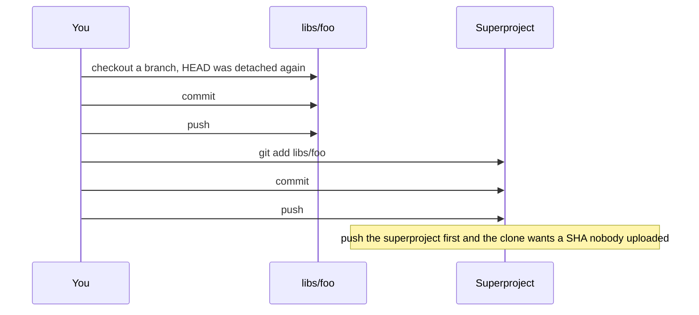
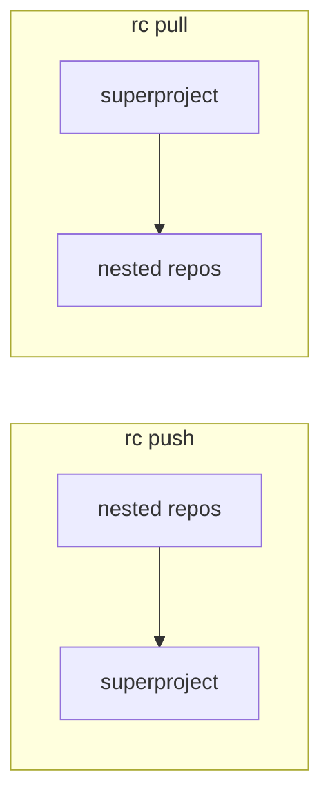

# recurse

Do you have a superproject full of submodules? Do you forget to commit the gitlink, push the child first, and then get detached for the trouble? 

I do. 

`recurse` (`rc`) does that ceremony. Checkout, rebase, log, and diff stay git.

## Day to day

```
# rc with no arguments is `rc status`
rc
# edit the superproject, a nested repo, or both
rc commit -m "fix: widget"
rc push
```

On the other machine, `rc pull`. After `git checkout` of another superproject commit, `rc update` checks out those gitlinks and leaves HEAD on a branch. To take a submodule's upstream, `git pull` in that repo, then `rc commit`.



`rc commit` writes nested repos deepest first, one message, then the superproject with the new gitlinks. `rc push` uploads those repos, then the superproject. The superproject stays local until every gitlink it records is already on a remote.



Push follows your commits out. Pull follows the lockfile in. A nested commit can land before the superproject commit exists. Push will not publish a pin that is not on a remote. `rc update` will not rewind a branch that is ahead of the pin.

## Commands

| Command | What it does |
|---|---|
| `rc` / `rc status` | The whole tree. No fetch. Branch or detached, dirty, untracked, the checkout SHA, and `pin <sha>` when that checkout is not the recorded gitlink. `ahead` / `behind` are that branch against its upstream. Exits 0 with dirt. An unborn superproject prints. |
| `rc update [PATH]` | Check out each recorded gitlink and attach a branch: `branch=` in `.gitmodules`, else the current branch, else a local branch already at that SHA. Fast-forward when the pin is ahead. Refuse, before any checkout, when the branch is ahead, the histories diverged, or the only option is detached. Tracked dirt fails. Untracked files do not. |
| `rc commit [-m MSG]` | One message, deepest dirty repo first, then the superproject. The editor opens once when `-m` is omitted. A stop names the repo, lists what already committed, and says the superproject was not updated. A clean submodule whose HEAD is not the recorded gitlink is still staged. `rc commit libs/foo` is that repo and its descendants. Staged files outside that path stay staged and the commit refuses. |
| `rc pull` | Fast-forward the superproject from the current branch's upstream, then `rc update`. No path. Tracked dirt fails first. `pull.ff` other than `only` is rejected. A nested branch ahead of the incoming pin fails before any repo moves. |
| `rc push` | Nested repos that are ahead, deepest first, then the superproject. The destination is the upstream branch name (`main` tracking `upstream/trunk` lands on `trunk`). The superproject is not pushed until every affected gitlink is already on a remote, or this push just uploaded it. |

```
. ........................ main a40529f  clean
  libs/foo ............... main 3395016  dirty
  vendor/openssl ......... main 11aa22b  pin a40529f ahead 1
```

Color follows the terminal: `--color auto` (the default), `always`, or `never`. `auto` stays plain when stdout is not a terminal or `NO_COLOR` is set. `clean` is green, `dirty` is red, `untracked` and a detached or unborn branch are yellow, the branch and `ahead` / `behind` are cyan, `pin` is magenta, and the SHA is dim.

A path on `update`, `commit`, and `push` limits the walk to that submodule and its descendants. An unknown path is an error. The path in every failure is the repo that failed.

Git still keeps `.gitmodules`, `branch=`, and the gitlinks.
