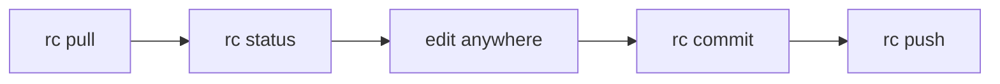
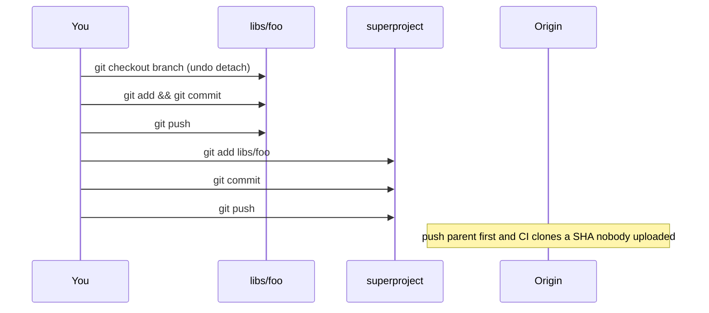
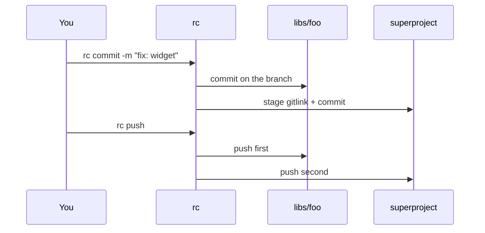
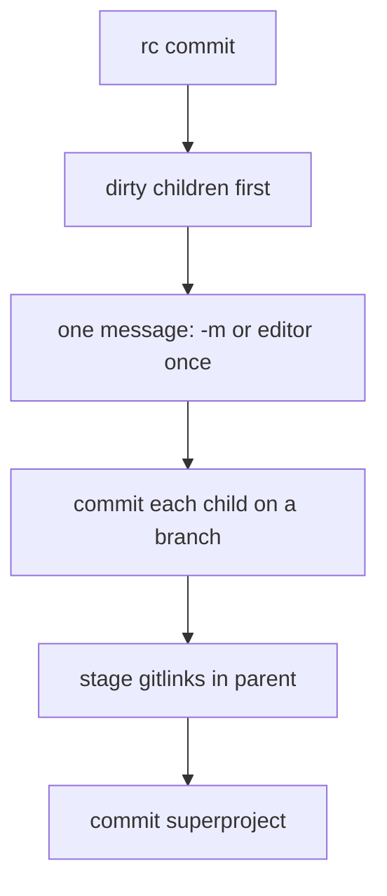
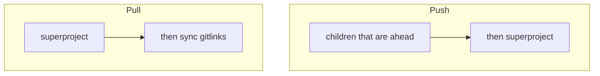
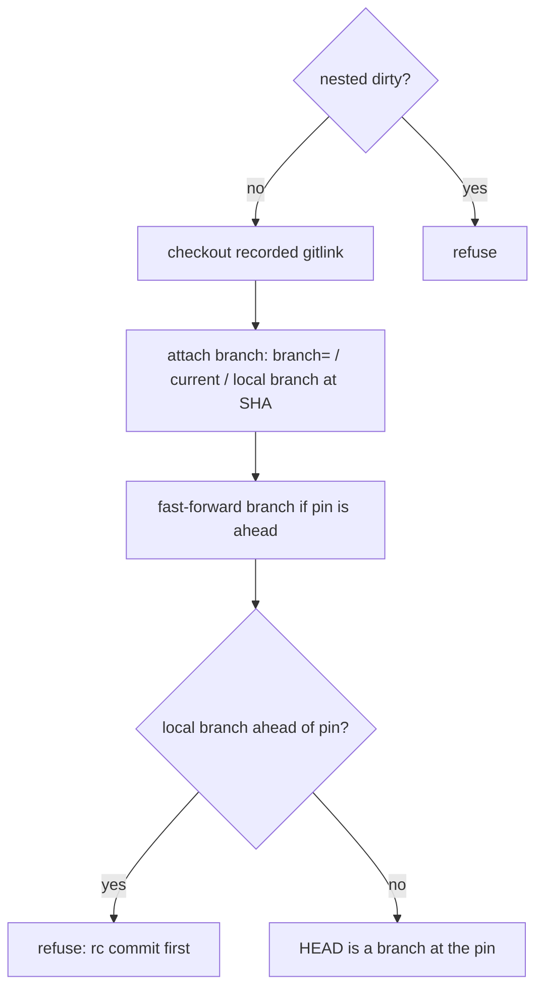
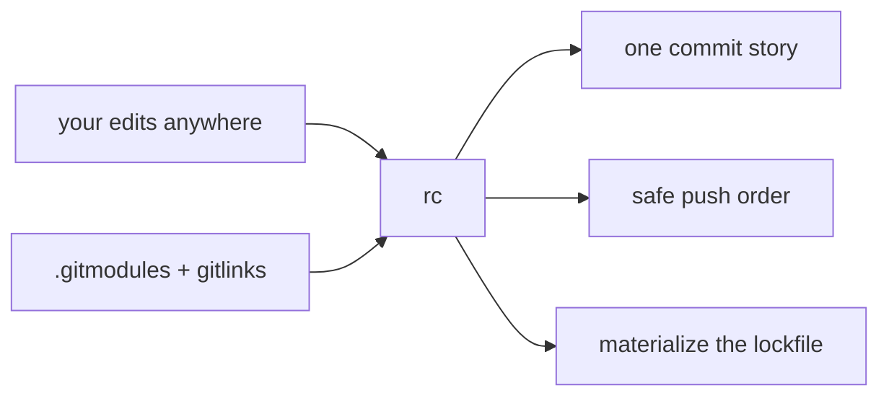

# Recurse workflow

Git submodules are several repositories pretending to be one tree. Recurse (`rc`) makes them **feel like one repo**. The superproject gitlink is the lockfile; you do not babysit it.

Alias: `rc=recurse`. `rc` with no command is `status`.

## Daily loop

Same muscle memory as a single repository.



```
rc                      # whole-tree status
# edit parent files and/or nested repos
rc commit -m "fix: widget"
rc push
```

On another machine:

```
rc pull
```

That is the whole happy path.

## What git makes you do

Without Recurse, a change that touches `libs/foo` looks like this:



Miss a step and you get the classic failures: detached HEAD, parent commit pointing at a SHA that is not on the remote, `git pull` that does not update nested worktrees, `git submodule update` that detaches you again.

## What Recurse does instead



One message, children then parent, push in the only order that is safe.

## Commit: one logical change

`rc commit` is the monorepo write. Same message on every dirty child, then a **superproject** commit that records the new gitlinks (and any parent files). Children-only is a failed commit.



```
rc commit -m "fix: widget alignment"
rc commit                 # one editor; that text is reused everywhere
```

Detached children are refused. `rc sync` attaches a branch so this does not become a ritual.

## Push and pull: opposite arrows



| | Direction | Source of truth |
|---|---|---|
| `rc push` | children → parent | your local commits |
| `rc pull` | parent → children | the recorded gitlinks |

`rc pull` is a stricter `git pull --recurse-submodules`: fail if dirty, ff-only parent, then `rc sync`. Nested branch tips do **not** race ahead of the lockfile.

To absorb upstream in one nested repo (the old “promote”):

```
rc pull libs/foo
rc commit -m "chore: update foo"
rc push
```

## Sync: match the lockfile, stay on a branch

`git submodule update` checks out a SHA, which is detached by definition. Git does that so it will not move your branch pointer. Recurse still checks out the gitlink, then **attaches** a branch at that SHA.



```
rc sync
```

You can `rc commit` afterwards without `git checkout` in each child.

## Status is the map

`rc status` is recursive. It is also the doctor: dirty, detached, gitlink mismatch, uninitialized, ahead/behind. No extra command.

```
.                        main         clean  a40529f
  libs/foo               main         3395016 dirty
  vendor/openssl         main         11aa22b mismatch ahead 1
```

`rc verify` (CI) fetches and fails if a recorded gitlink does not exist on the submodule remote — the unpushed-pin bug, caught on purpose.

```
rc verify --json
```

## Mental model



Git still owns what exists. Recurse owns **motion**: commit, push, pull, sync, and the status that makes the tree look like one repo.
